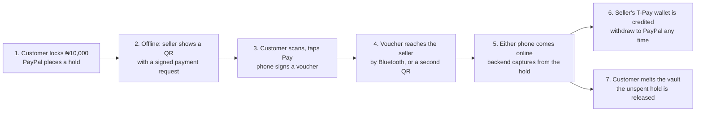

# T-Pay

**Offline payments backed by PayPal, for markets where the network fails.**

A customer locks money in a PayPal-backed vault while they are online. Later, with no internet at all, they pay a seller phone to phone by QR code or Bluetooth. Each payment is a voucher signed by the customer's own phone, so it can't be forged or spent twice. When either phone reconnects, the backend captures the money from the PayPal hold and credits the seller, who can withdraw to PayPal. A voice assistant built on Gemini lets people ask for payments in English, Nigerian Pidgin, Yoruba, Igbo or Hausa.

Built for the PayPal AI Hackathon, November 2026. MIT licensed.

---

## How a payment works



| Guarantee | How it is enforced |
| :--- | :--- |
| Only the customer can create a payment | Vouchers are signed with a P-256 key that never leaves the customer's phone. The backend checks them against the key the customer registered. |
| No double spending | The money is held by PayPal, the vault certificate states its size, and each voucher has a sequence number. A reused sequence blocks the vault, and so does a total above the hold. |
| Either side can settle | The seller or the customer can submit a voucher. Resubmitting returns the stored result with no second capture. |
| Offline sellers still get paid | The hold stays until the customer melts the vault in T-Pay, for up to 28 days. It is renewed every three days, while PayPal still guarantees the money. |
| AI never moves money | The assistant only proposes. A person confirms on screen, and only the normal signing step can pay. |

---

## What is built

| Area | Status |
| :--- | :--- |
| Backend API: devices, vaults, vouchers, settlement, melt, wallet, withdrawals, webhooks, history | Done. 509 tests pass, plus 229 API tests on real Postgres. |
| PayPal sandbox: Orders, authorisation, capture, void, reauthorisation, Payouts, webhooks | Done. Reauthorisation only becomes possible on day four of a real hold, so it hasn't been proven in the sandbox yet. |
| Gemini assistant (`POST /api/assistant/interpret`) | Done. Live-checked in all five languages, and with prompt-injection attempts. |
| Offline payment rules, signing, frames for QR and Bluetooth (`shared/`) | Done and tested |
| Android app (`frontend/`) | Screens are designed. They still run on sample data and aren't wired to the API yet. |

---

## PayPal and AI used

**PayPal (sandbox).**

| Product | Used for |
| :--- | :--- |
| Orders v2, intent `AUTHORIZE` | Locking a vault with the customer's approval |
| Payments v2: capture, void and reauthorise | Settling vouchers, releasing holds, and keeping holds guaranteed |
| Webhooks | Capture results, refunds, reversals and voids |
| Payouts | Sellers withdrawing their T-Pay balance to PayPal |

**AI.** Google Gemini (`gemini-3.5-flash`), called through `@google/genai` on the backend only:

1. The app sends what the person said, as text or recorded audio, plus their language.
2. Gemini returns a structured proposal, such as "collect ₦1,000" or "pay ₦2,000 for an item".
3. The backend validates that proposal and refuses any payment above what the vault has left.
4. The app pre-fills its screen and asks the person to confirm.

The model never sees keys, tokens, balances or signed data. Every call is logged with its outcome, but what the person said isn't logged. With no network, the app falls back to a rule-based assistant, which is labelled as offline assistance.

---

## Repository

```text
backend/    Node, TypeScript, Express API. PayPal, Postgres, Gemini, settlement and jobs.
shared/     Payment rules used by both sides: money, signing, certificates, vouchers, frames.
            No dependencies, so it runs unchanged in Node and React Native.
frontend/   Expo (React Native) Android app.
docs/       PRD, API contract, backend and frontend workflows (Markdown, Word and PDF).
```

The [API contract](docs/T-Pay-API-Contract.md) is the source of truth for every endpoint and offline message.

---

## Run the backend locally

You need **Node 22 or later**, **Docker** (Docker Desktop on Windows), and a **PayPal developer account** with sandbox app credentials.

```bash
cd backend
npm install
cp .env.example .env
```

On Windows, use `copy .env.example .env` instead of `cp`. Then fill in `backend/.env`:

1. Run `npm run keys:root` and paste the two lines it prints. This is the T-Pay key that signs device and vault certificates.
2. Set `PAYPAL_CLIENT_ID` and `PAYPAL_CLIENT_SECRET`, from developer.paypal.com → Apps & Credentials, in sandbox mode.
3. Optionally set `GEMINI_API_KEY`. A free key comes from aistudio.google.com → Get API key. Without it, the assistant returns `AI_UNAVAILABLE` and the app uses its offline path.

Start the database, create the tables, then run the API:

```bash
npm run db:up
npm run db:migrate
npm run dev
```

Open http://localhost:4000/api/health. It should report `"database": "ok"` and `"paypal": "ok"`.

To check the PayPal sandbox end to end, run `npm run paypal:proof`. You approve one order in the browser, and the script then places a hold, makes two partial captures and releases the rest. If `PAYPAL_PROOF_PAYOUT_EMAIL` is set, it also sends a test payout.

### Environment variables

| Name | Required | Purpose |
| :--- | :--- | :--- |
| `DATABASE_URL` | Yes | Postgres connection. Locally, the Docker database on port 5433; in production, Neon. |
| `ROOT_PRIVATE_KEY`, `ROOT_PUBLIC_KEY` | Yes | Certificate signing key, from `npm run keys:root`. The app ships with the public key. |
| `PAYPAL_CLIENT_ID`, `PAYPAL_CLIENT_SECRET` | Yes | PayPal sandbox app credentials |
| `PAYPAL_BASE_URL` | Yes | `https://api-m.sandbox.paypal.com` |
| `PUBLIC_BASE_URL` | Yes | Where PayPal returns the customer after approval. `http://localhost:4000` locally. |
| `PAYPAL_WEBHOOK_ID` | For webhooks | From the webhook you add in the PayPal app. Until it is set, every webhook is refused. |
| `GEMINI_API_KEY` | For the assistant | Google AI Studio key |
| `GEMINI_MODEL` | No | Defaults to `gemini-3.5-flash` |
| `FX_RATE` | No | Fixed demo rate, in naira per US dollar. Defaults to `1500.00`. |
| `PORT` | No | Defaults to `4000` |

### Tests

```bash
npm test
npm run test:db
npm run lint
```

- `npm test` runs every test, using in-memory storage.
- `npm run test:db` runs the same suite against the Docker Postgres. It needs `npm run db:up` first, and works on Windows, macOS and Linux.
- `npm run lint` typechecks the backend and `shared/`.

### Try the API by hand

Import [`backend/postman/T-Pay.postman_collection.json`](backend/postman/T-Pay.postman_collection.json) into Postman and set `baseUrl`. Registration, vouchers and spend statements must be signed, so generate their bodies with the helper and paste them in:

```bash
npm run postman -- device ada
npm run postman -- voucher ada bola 1 200000
npm run postman -- statement ada 1 133
```

Every response carries an `X-Request-Id` header. The same ID appears on that request's lines in the server log.

---

## Deploy on Render with Neon

1. Create a **Web Service** from this repository, with root directory `backend`.
2. Build command: `npm install`. Start command: `npm run db:migrate && npm start`. Running migrations on every start keeps the database in step with the code, and it is safe to repeat.
3. Add the environment variables above. `DATABASE_URL` is the Neon connection string, `PUBLIC_BASE_URL` is the Render URL, and `PAYPAL_BASE_URL` stays on the sandbox.
4. In the PayPal app, add a webhook to `https://<your-render-url>/api/webhooks/paypal` for these events, then set `PAYPAL_WEBHOOK_ID`:
   - `PAYMENT.CAPTURE.COMPLETED`, `PAYMENT.CAPTURE.PENDING`
   - `PAYMENT.CAPTURE.DECLINED`, `PAYMENT.CAPTURE.DENIED`
   - `PAYMENT.CAPTURE.REFUNDED`, `PAYMENT.CAPTURE.REVERSED`
   - `PAYMENT.AUTHORIZATION.VOIDED`
   - `CHECKOUT.PAYMENT-APPROVAL.REVERSED`

---

## Run the app

```bash
cd frontend
npm install
npm start
```

Open it in Expo Go, or build an APK with EAS. The screens currently use sample data from `frontend/src/demo/store.tsx`. That file goes away once the screens are wired to the API.

---

## For judges

> **To complete before submission.** Replace each placeholder below.

| Item | Link |
| :--- | :--- |
| Android APK | *APK link to come* |
| Hosted backend | *Render URL to come* (health check at `/api/health`) |
| Demo video | *YouTube link to come* |
| Sandbox test logins | *Customer and seller PayPal sandbox accounts to come* |

**Demo, on two Android phones:**

1. The customer locks a vault with a real PayPal sandbox approval.
2. Turn on airplane mode on both phones, then turn Bluetooth back on. The phones can reach each other, but not the internet.
3. The seller says "Abeg collect one thousand", or types it, and shows the payment QR.
4. The customer scans it, checks the amount, and taps **Pay**. The voucher reaches the seller over Bluetooth. With Bluetooth off, the seller scans a second QR instead.
5. Both phones show the payment as pending. A payment above the vault's remaining amount is refused, and so is a changed voucher.
6. Reconnect either phone. The voucher settles automatically, and the PayPal capture ID appears on both phones and in the sandbox.
7. The customer melts the vault, and the unspent hold is released in PayPal.

---

## Honest limits

- **Sandbox only.** No live PayPal mode, no real money, and no KYC.
- **Device keys** are protected by Android secure storage (assurance Tier B), not a hardware secure element.
- **Exchange rate:** one fixed demo rate (`FX_RATE`), not a market rate.
- **Hold limit:** a vault can wait at most 28 days. After that, PayPal ends the hold whatever T-Pay does.
- **Offline assistant:** with no network it is rule-based, and it says so.
- **Gemini free tier:** limited to 5 requests a minute, and Google may use free-tier prompts to improve its products. Use sandbox data only.
- **Language review:** a native speaker still needs to check the Yoruba, Igbo and Hausa assistant lines.

## Documents

- [Product requirements (PDF)](docs/T-Pay-PRD.pdf) · [Markdown source](docs/T-Pay-PRD.md)
- [API contract](docs/T-Pay-API-Contract.md)
- [Backend workflow](docs/T-Pay-Backend-Workflow.md) · [Frontend workflow](docs/T-Pay-Frontend-Workflow.md)

In `docs/`, `npm run docx` rebuilds the Word files and `npm run pdf` rebuilds the PRD PDF.

## License

[MIT](LICENSE) © 2026 T-Pay team
