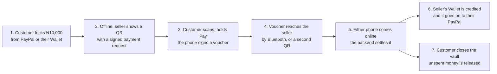

# T-Pay

**Offline payments backed by PayPal, for markets where the network fails.**

A customer locks money into an **Offline vault** while they are online, either from PayPal or from their T-Pay **Wallet**. Later, with no internet at all, they pay a seller phone to phone by QR code or Bluetooth. Each payment is a voucher signed by the customer's own phone, so it can't be forged or spent twice. When either phone reconnects, the backend settles it into the seller's Wallet, and the money goes on to the seller's PayPal by itself. A voice assistant answers in English, Nigerian Pidgin, Yoruba, Igbo and Hausa, with Gemini online and a model on the phone offline.

Built for the PayPal AI Hackathon, November 2026. MIT licensed.

---

## How a payment works



| Guarantee | How it is enforced |
| :--- | :--- |
| Only the customer can create a payment | Vouchers are signed with a P-256 key that never leaves the customer's phone. The backend checks them against the key the customer registered. |
| No double spending | The vault certificate states how much is locked, and each voucher has the next sequence number. The phone counts a voucher the moment it signs it. A reused sequence or a total above the lock is refused, and the vault is blocked. |
| Locked money stays locked | Only a signed payment takes money out of the Offline vault. Closing it needs the PIN or fingerprint and returns only what was never spent. Money already paid stays payable to its holder for up to 28 days. |
| Money received offline is never re-spent unsettled | It is queued, then lands in the Wallet when it settles. Until then it can still be refused, so it never goes into an Offline vault. |
| Either side can settle | The seller or the customer can submit a voucher. Resubmitting returns the stored result with no second capture. |
| AI never moves money | The assistant only proposes. A person confirms on screen, and paying still needs the hold on the Pay button. |

---

## What is built

| Area | What it does |
| :--- | :--- |
| **Two wallets** | The **Offline vault** pays with no network. The **Wallet** holds what you receive and what you add, and you can withdraw it to PayPal. |
| **Locking money** | From PayPal (an authorisation hold), or straight from the Wallet with no PayPal step. One vault at a time, up to 28 days. |
| **Paying offline** | Seller's QR, then the customer's signed voucher back by Bluetooth or a second QR. Works in airplane mode. |
| **Getting paid offline** | **Get paid** works from either wallet. A payment taken offline shows as "received, queued" and lands in the Wallet when it settles. Once settled, the app offers to lock it into a new vault in one tap. |
| **Automatic cash-out** | Money received offline goes on to your own PayPal by itself, batched into one payout. It's on by default, and you can turn it off in Profile. |
| **Add money and pay links** | Top up the Wallet through PayPal checkout, or share a link anyone can pay with PayPal, with no T-Pay app needed. |
| **Personal and Business accounts** | Business opens on the Wallet, keeps Bluetooth on to receive, and adds **Stock** and a monthly **Budget**. Saying "I sold one Coke for 500" records the sale and takes one off the shelf. |
| **Voice assistant** | Hold the mic and talk, or press the volume button for hands-free. Clear requests are answered on the phone at once. Everything else goes to Gemini online, or to an optional model on the phone offline. Replies are spoken, and so are results and money arriving. |
| **Security** | PIN and fingerprint unlock, PIN to send money or close a vault, device keys in Android secure storage. |
| **Live status** | Money arriving shows and is spoken within seconds. Settings shows whether T-Pay and PayPal are up, and Home warns when PayPal is down. |

**Tests:** 852 backend tests in memory, 884 on real Postgres (migrations included) plus 441 API tests on Postgres storage, and 114 app tests. They all run on every push (see `.github/workflows/ci.yml`).

---

## PayPal and AI used

**PayPal (sandbox).**

| Product | Used for |
| :--- | :--- |
| Orders v2, intent `AUTHORIZE` | Locking an Offline vault with the customer's approval |
| Payments v2: capture, void and reauthorise | Settling vouchers, releasing holds, and keeping holds guaranteed |
| Orders v2, intent `CAPTURE` | Adding money to the Wallet, and pay links |
| Payouts | Withdrawals, and automatic cash-out of money received offline |
| Webhooks | Capture results, refunds, reversals and voids |

**AI.**

1. **On the phone first.** Reviewed rules read clear requests ("collect 2k", "how much do I have") instantly, online or offline.
2. **Gemini online** (`gemini-3.5-flash` through `@google/genai`, backend only). It reads the rest, including sales and Yoruba, Igbo and Hausa numbers, from text or recorded audio, and returns a structured proposal. The backend checks it and refuses any payment above what the vault has left.
3. **On-device model offline** (optional download, `llama.rn`). It runs only when the rules can't read a request, and its answer goes through the same checks.
4. **Voice.** Replies use the phone's voice so they start at once. Gemini's voice (`POST /api/assistant/speak`) covers languages the phone has no voice for.

The model never sees keys, tokens, balances or signed data. Every answer is logged with its outcome, but what the person said isn't logged.

---

## Repository

```text
backend/    Node, TypeScript, Express API. PayPal, Postgres, Gemini, settlement and background jobs.
shared/     Payment rules used by both sides: money, signing, certificates, vouchers, frames, intent rules.
            No dependencies, so it runs unchanged in Node and React Native.
frontend/   Expo SDK 58 (React Native) Android app.
docs/       PRD, API contract, backend and frontend workflows (Markdown, Word and PDF).
```

The [API contract](docs/T-Pay-API-Contract.md) is the source of truth for every endpoint and offline message.

---

## Run the backend locally

You need **Node 22 or later**, **Docker** (Docker Desktop on Windows), and a **PayPal developer account** with sandbox app credentials.

```bash
cd backend
npm install
cp .env.example .env
```

On Windows, use `copy .env.example .env` instead of `cp`. Then fill in `backend/.env`:

1. Run `npm run keys:root` and paste the two lines it prints. This is the T-Pay key that signs device and vault certificates.
2. Set `PAYPAL_CLIENT_ID` and `PAYPAL_CLIENT_SECRET`, from developer.paypal.com → Apps & Credentials, in sandbox mode.
3. Optionally set `GEMINI_API_KEY`. A free key comes from aistudio.google.com → Get API key. Without it, the assistant returns `AI_UNAVAILABLE` and the app uses its offline path.

Start the database, create the tables, then run the API:

```bash
npm run db:up
npm run db:migrate
npm run dev
```

Open http://localhost:4000/api/health. It should report `"database": "ok"` and `"paypal": "ok"`.

To check the PayPal sandbox end to end, run `npm run paypal:proof`. You approve one order in the browser, and the script then places a hold, makes two partial captures and releases the rest. If `PAYPAL_PROOF_PAYOUT_EMAIL` is set, it also sends a test payout.

### Environment variables

| Name | Required | Purpose |
| :--- | :--- | :--- |
| `DATABASE_URL` | Yes | Postgres connection. Locally, the Docker database on port 5433; in production, Neon. |
| `ROOT_PRIVATE_KEY`, `ROOT_PUBLIC_KEY` | Yes | Certificate signing key, from `npm run keys:root`. The app ships with the public key. |
| `PAYPAL_CLIENT_ID`, `PAYPAL_CLIENT_SECRET` | Yes | PayPal sandbox app credentials |
| `PAYPAL_BASE_URL` | Yes | `https://api-m.sandbox.paypal.com` |
| `PUBLIC_BASE_URL` | Yes | Where PayPal returns the customer after approval. `http://localhost:4000` locally. |
| `PAYPAL_WEBHOOK_ID` | For webhooks | From the webhook you add in the PayPal app. Until it is set, every webhook is refused. |
| `GEMINI_API_KEY` | For the assistant | Google AI Studio key |
| `GEMINI_MODEL` | No | Defaults to `gemini-3.5-flash` |
| `GEMINI_TTS_MODEL` | No | The voice model for `/api/assistant/speak`. Defaults to `gemini-3.8-flash-tts`. |
| `FX_RATE` | No | Fixed demo rate, in naira per US dollar. Defaults to `1500.00`. |
| `PORT` | No | Defaults to `4000` |

### Tests

```bash
npm test
npm run test:db
npm run lint
```

- `npm test` runs every test, using in-memory storage.
- `npm run test:db` runs the same suite against the Docker Postgres. It needs `npm run db:up` first, and works on Windows, macOS and Linux.
- `npm run lint` typechecks the backend and `shared/`.

### Try the API by hand

Import [`backend/postman/T-Pay.postman_collection.json`](backend/postman/T-Pay.postman_collection.json) into Postman and set `baseUrl`. Registration, vouchers and spend statements must be signed, so generate their bodies with the helper and paste them in:

```bash
npm run postman -- device ada
npm run postman -- voucher ada bola 1 200000
npm run postman -- statement ada 1 133
```

Every response carries an `X-Request-Id` header. The same ID appears on that request's lines in the server log.

---

## Deploy on Render with Neon

1. Create a **Web Service** from this repository, with root directory `backend`.
2. Build command: `npm install`. Start command: `npm run db:migrate && npm start`. Running migrations on every start keeps the database in step with the code, and it is safe to repeat.
3. Add the environment variables above. `DATABASE_URL` is the Neon connection string, `PUBLIC_BASE_URL` is the Render URL, and `PAYPAL_BASE_URL` stays on the sandbox.
4. In the PayPal app, add a webhook to `https://<your-render-url>/api/webhooks/paypal` for these events, then set `PAYPAL_WEBHOOK_ID`:
   - `PAYMENT.CAPTURE.COMPLETED`, `PAYMENT.CAPTURE.PENDING`
   - `PAYMENT.CAPTURE.DECLINED`, `PAYMENT.CAPTURE.DENIED`
   - `PAYMENT.CAPTURE.REFUNDED`, `PAYMENT.CAPTURE.REVERSED`
   - `PAYMENT.AUTHORIZATION.VOIDED`
   - `CHECKOUT.PAYMENT-APPROVAL.REVERSED`

---

## Run the app

```bash
cd frontend
npm install
cp .env.example .env
```

Set `EXPO_PUBLIC_API_URL` to the backend (a phone can't reach `localhost`, so use the Render URL or your laptop's network address) and `EXPO_PUBLIC_ROOT_PUBLIC_KEY` to the public key from `npm run keys:root`.

The app uses native modules (Bluetooth, fingerprint, speech, the on-device model), so it needs a development build, not Expo Go:

```bash
npx expo run:android                              # on a connected phone or emulator
npx eas build --profile preview --platform android  # an installable APK
```

`npm test` runs the app tests and `npm run typecheck` checks types.

---

## For judges

> **To complete before submission.** Fill in the three rows still in italics.

| Item | Link |
| :--- | :--- |
| Hosted backend | https://t-pay-public.onrender.com (health check at [`/api/health`](https://t-pay-public.onrender.com/api/health)) |
| Android APK | *APK link to come* |
| Demo video | *YouTube link to come* |
| Sandbox test logins | *Customer and seller PayPal sandbox accounts to come* |

The backend runs on Render's free plan, which sleeps when idle. The first request after a while can take up to a minute; after that it answers at once.

**Demo, on two Android phones:**

1. The customer locks ₦10,000 into the Offline vault, from the Wallet or with a PayPal sandbox approval.
2. Turn on airplane mode on both phones, then turn Bluetooth back on. The phones can reach each other, but not the internet.
3. The seller holds the mic and says "Abeg collect one thousand". The app answers at once and shows the payment QR.
4. The customer scans it, checks the amount, and holds **Pay**. The voucher reaches the seller over Bluetooth. With Bluetooth off, the seller scans a second QR instead.
5. Both phones show the payment as queued. A payment above what the vault has left is refused, and so is a changed voucher.
6. Reconnect either phone. The payment settles into the seller's Wallet, and the app says so out loud. With automatic cash-out on, it goes on to the seller's PayPal.
7. The customer closes the vault with their PIN, and the unspent money is released.

---

## Honest limits

- **Sandbox only.** No live PayPal mode, no real money, and no KYC.
- **Device keys** are protected by Android secure storage, not a hardware secure element.
- **Exchange rate:** one fixed demo rate (`FX_RATE`), not a market rate.
- **Hold limit:** a vault can wait at most 28 days. After that, PayPal ends the hold whatever T-Pay does.
- **Offline assistant:** the rules always work. Smarter offline answers need the optional model download.
- **Gemini free tier:** limited requests a minute, and Google may use free-tier prompts to improve its products. Use sandbox data only.
- **Language review:** a native speaker still needs to check the Yoruba, Igbo and Hausa lines.
- **Payouts to Nigeria:** PayPal accounts in some countries can't receive payouts. The sandbox doesn't show this.

## Documents

- [Product requirements (PDF)](docs/T-Pay-PRD.pdf) · [Markdown source](docs/T-Pay-PRD.md)
- [API contract](docs/T-Pay-API-Contract.md)
- [Backend workflow](docs/T-Pay-Backend-Workflow.md) · [Frontend workflow](docs/T-Pay-Frontend-Workflow.md)

In `docs/`, `npm run docx` rebuilds the Word files and `npm run pdf` rebuilds the PRD PDF.

## License

[MIT](LICENSE) © 2026 T-Pay team
